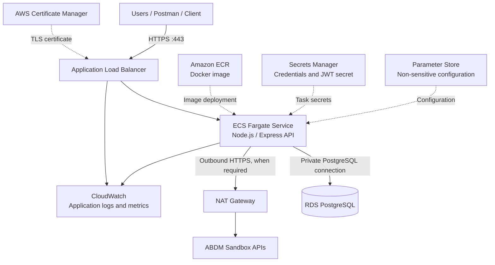

# Child Health API — AWS Deployment Guide

This README describes a small-pilot deployment of the Child Health API on **Amazon ECS with AWS Fargate**, using an **Application Load Balancer (ALB)** and **Amazon RDS for PostgreSQL**.

The proposed design runs the Node.js/Express backend as one modular application in a Docker container. It does not split individual API endpoints into separate Lambda functions.

> **Deployment status:** This is a deployment plan and implementation guide. It is not evidence that the AWS resources have already been created or that the API has been deployed.

---

## 1. Architecture overview

### Selected AWS services

| Responsibility | AWS service | Purpose |
|---|---|---|
| Application compute | Amazon ECS with AWS Fargate | Runs the Node.js/Express container without managing EC2 servers |
| API exposure | Application Load Balancer | Receives HTTPS traffic and forwards requests to healthy ECS tasks |
| Database | Amazon RDS for PostgreSQL | Stores guardian, child, and vaccination-reminder data |
| Container registry | Amazon Elastic Container Registry (ECR) | Stores versioned Docker images |
| Secrets | AWS Secrets Manager | Stores database credentials, JWT signing secret, and ABDM sandbox credentials |
| Configuration | AWS Systems Manager Parameter Store | Stores non-sensitive configuration values |
| TLS certificates | AWS Certificate Manager (ACM) | Provides the certificate used by the ALB HTTPS listener |
| Logs and monitoring | Amazon CloudWatch | Collects application logs, metrics, and alarms |
| AWS permissions | AWS Identity and Access Management (IAM) | Grants least-privilege permissions to deployment and application components |
| Network controls | Amazon VPC and Security Groups | Separates public entry points, application tasks, and the database |
| AWS activity auditing | AWS CloudTrail | Records AWS account activity and API actions |

### Architecture diagram



### Network placement

- **Public subnets:** Application Load Balancer and NAT Gateway.
- **Private application subnets:** ECS Fargate tasks.
- **Private database subnets:** RDS PostgreSQL, preferably in a dedicated DB subnet group.
- **Database exposure:** RDS should not be publicly accessible. Its security group should accept PostgreSQL traffic only from the ECS task security group.
- **Outbound access:** If private ECS tasks must call ABDM sandbox endpoints or retrieve external resources, provide controlled outbound connectivity. A NAT Gateway is one option and has additional hourly and data-processing charges.

For a more highly available production setup, distribute the ALB and application tasks across multiple Availability Zones and evaluate Multi-AZ RDS. The small-pilot baseline below is intentionally simpler and cheaper.

---

## 2. Application and database preparation

The current application uses SQLite. This deployment plan uses PostgreSQL so the database can be managed independently of the application containers and shared safely by multiple application tasks.

Before deployment:

1. Replace the SQLite-specific repository/database access with PostgreSQL-compatible access.
2. Create PostgreSQL tables for the existing entities: `guardians`, `children`, and `vaccination_reminders`.
3. Preserve primary keys, foreign keys, uniqueness constraints, and ownership relationships.
4. Prepare and test database migrations.
5. Migrate any required existing data from SQLite and verify record counts and relationships.
6. Ensure the application reads database settings from environment variables or the configured secret references.
7. Ensure the Express server listens on `0.0.0.0` and the configured container port (default below: `3000`).
8. Ensure `GET /health` returns a successful response when the application is ready to receive traffic.

**Important:** The existing `better-sqlite3` repository code cannot connect to PostgreSQL unchanged. The database/repository layer must be adapted and tested before deploying this architecture.

---

## 3. Containerize the API

Add a production Dockerfile to the project if one does not already exist. A basic example is shown below; adjust the entry point and package-manager commands to match the actual project.

```dockerfile
FROM node:22-alpine

WORKDIR /app

ENV NODE_ENV=production
ENV PORT=3000

COPY package*.json ./
RUN npm ci --omit=dev

COPY . .

EXPOSE 3000

CMD ["npm", "start"]
```

Add a `.dockerignore` file so local development files and secrets are not copied into the image:

```text
node_modules
.git
.env
.env.*
coverage
*.log
```

Build and test the image locally before pushing it to ECR:

```bash
docker build -t child-health-api:local .
docker run --rm -p 3000:3000 --env-file .env child-health-api:local
```

Then test the local container:

```bash
curl http://localhost:3000/health
```

Do not copy `.env` files or real credentials into the Docker image.

---

## 4. AWS deployment procedure

The following steps describe the deployment sequence. Resource names, account IDs, subnet IDs, security-group IDs, and certificate ARNs must be filled in with values from the target AWS account.

### Step 1 — Select the region and configure the AWS CLI

Use the AWS region selected for the project. For an India-based pilot, Mumbai (`ap-south-1`) is a reasonable starting point, subject to latency, service availability, and cost requirements.

Configure and verify the AWS CLI:

```bash
aws configure
aws sts get-caller-identity
```

Use an IAM identity with only the permissions needed for the deployment. Do not use root-account credentials for routine work.

### Step 2 — Create the ECR repository

Create a repository to store the API image:

```bash
aws ecr create-repository \
  --repository-name child-health-api \
  --region ap-south-1
```

Authenticate Docker to ECR. Replace `<ACCOUNT_ID>` with the AWS account ID:

```bash
aws ecr get-login-password --region ap-south-1 | docker login \
  --username AWS \
  --password-stdin <ACCOUNT_ID>.dkr.ecr.ap-south-1.amazonaws.com
```

Build, tag, and push the image:

```bash
docker build -t child-health-api:latest .

docker tag child-health-api:latest \
  <ACCOUNT_ID>.dkr.ecr.ap-south-1.amazonaws.com/child-health-api:latest

docker push \
  <ACCOUNT_ID>.dkr.ecr.ap-south-1.amazonaws.com/child-health-api:latest
```

For repeatable deployments, use an immutable version tag (for example, a Git commit SHA) rather than relying only on `latest`.

### Step 3 — Create the RDS PostgreSQL database

1. Create an RDS PostgreSQL instance using a pilot-appropriate instance class and storage allocation.
2. Disable public accessibility.
3. Place the database in private database subnets using a DB subnet group.
4. Configure the RDS security group to allow TCP port `5432` only from the ECS task security group.
5. Store the database username and password in Secrets Manager.
6. Run the database migrations from a controlled deployment environment that can reach the private database.
7. Verify that the application can connect and perform required reads and writes.

Do not expose the RDS endpoint directly to the public internet.

### Step 4 — Store secrets and configuration

Store sensitive values in AWS Secrets Manager, for example:

- PostgreSQL username and password (or a database connection secret).
- JWT signing secret.
- ABDM sandbox credentials, when those credentials are used by the application.

Store non-sensitive configuration in Parameter Store, for example:

- `NODE_ENV=production`
- `PORT=3000`
- ABDM sandbox base URL.
- Application-specific feature flags that do not contain secrets.

Grant the ECS task role permission to retrieve only the specific secrets and parameters required by this service. Avoid placing secrets in source control, task-definition plaintext fields, Docker build arguments, or image layers.

### Step 5 — Create the ECS Fargate service

1. Create an ECS cluster.
2. Create a task execution role that allows ECS to pull the image from ECR and write logs to CloudWatch.
3. Create an application task role with only the runtime permissions required by the API (for example, access to named Secrets Manager secrets and Parameter Store parameters).
4. Create a task definition using the ECR image.
5. Set the container port to `3000`, or to the port configured by the application.
6. Configure CPU and memory for a small pilot, then adjust using observed metrics.
7. Configure the task to run in private application subnets.
8. Configure the task security group to accept inbound traffic on the application port only from the ALB security group.
9. Configure CloudWatch log routing for the container.
10. Create an ECS service with an initial desired count of one task and attach it to the ALB target group.

The ALB target group should use the application's health endpoint, such as `/health`, for health checks.

### Step 6 — Configure the Application Load Balancer and HTTPS

1. Create an internet-facing Application Load Balancer in public subnets.
2. Create a target group that targets the ECS service on the application port.
3. Request or import an ACM certificate for the API domain name.
4. Configure an ALB HTTPS listener on port `443` and attach the certificate.
5. Configure HTTP-to-HTTPS redirection on port `80`, if HTTP is enabled for the listener.
6. Configure the ALB security group to accept public HTTPS traffic. Restrict other inbound ports.
7. Associate the ECS service with the target group and verify that targets become healthy.

### Step 7 — Configure logging, metrics, and alarms

Send application logs to CloudWatch Logs. Configure CloudWatch metrics and alarms for relevant signals, such as:

- ALB HTTP 5xx responses and unhealthy targets.
- ECS CPU and memory utilisation.
- ECS task count and task restarts.
- RDS CPU, free storage, database connections, and freeable memory.
- Application-specific error rates, if emitted as custom metrics.

Enable CloudTrail for AWS account activity. CloudTrail is not a substitute for application audit logs.

### Step 8 — Verify the deployment

Use the ALB DNS name or configured API domain:

```bash
curl https://<API_DOMAIN>/health
```

Test the API endpoints using Postman or curl, including:

```text
POST /auth/register
POST /auth/login
POST /children
GET  /children/:id
POST /reminders
GET  /health
```

Verify at least the following:

- A valid guardian can authenticate.
- An authenticated guardian can access their own child's permitted data.
- A guardian cannot access another guardian's child.
- Invalid or expired JWTs are rejected.
- Reminder creation enforces child ownership and consent rules.
- Data remains available after the application task is replaced or restarted.
- The ALB marks unhealthy application tasks as unhealthy.
- Logs do not contain passwords, JWTs, database credentials, or unnecessary patient information.

---

## 5. Security and access control

### Network security

| Component | Inbound access | Outbound access |
|---|---|---|
| ALB | Public HTTPS on `443`; optional HTTP `80` only for redirect | To ECS target port |
| ECS tasks | Application port (for example, `3000`) from ALB security group only | PostgreSQL to RDS; HTTPS to required external services and AWS endpoints |
| RDS | PostgreSQL `5432` from ECS security group only | No public inbound access required |

### Application security

- Keep JWT authentication enabled for protected API routes.
- Enforce guardian ownership checks on child and reminder resources.
- Enforce consent checks before relevant health-data operations.
- Validate request payloads and apply rate limiting to authentication routes.
- Use HTTPS for all external API communication.
- Do not log sensitive request or response bodies, passwords, tokens, or unnecessary patient data.
- Restrict access to production logs and database snapshots.

### IAM security

- Use separate task execution and task roles.
- Follow least privilege: allow access only to the ECR repository, log group, secrets, and parameters needed by this service.
- Avoid long-lived access keys in application containers.
- Review IAM permissions and rotate secrets according to the project's operational policy.

---

## 6. Backup and recovery

For the pilot RDS database:

1. Enable automated backups with a proposed retention period of seven days.
2. Take a manual snapshot before database migrations and significant releases.
3. Use point-in-time recovery when recovery from an accidental change or deletion is required.
4. Periodically restore a snapshot to a separate database and verify the application can use the restored data.
5. Restrict access to backups and snapshots because they contain sensitive application data.

For a production deployment, define recovery objectives (RPO and RTO), assess Multi-AZ RDS, and document the recovery procedure. A backup is not considered verified until a restore has been tested.

---

## 7. Small-pilot cost considerations

The following is a **rough planning range**, not an AWS quote. Actual charges vary by region, selected capacity, uptime, traffic, data transfer, storage, log volume, and backup usage.

| Component | Cost behaviour | Pilot consideration |
|---|---|---|
| ECS Fargate | CPU and memory are billed while tasks run | One small task is the lowest-complexity starting point; it still incurs compute cost while idle |
| Application Load Balancer | Hourly charge plus capacity-unit usage | Has a baseline cost even with low traffic |
| RDS PostgreSQL | Instance runtime, storage, and applicable backup charges | Single-AZ is cheaper for a pilot than Multi-AZ |
| NAT Gateway | Hourly charge plus data processing | Can be a significant fixed cost; include it only if the private-subnet egress design requires it |
| ECR | Image storage | Keep a small number of retained image versions |
| Secrets Manager | Per-secret and API usage charges | Store only required secrets |
| CloudWatch | Log ingestion, retention, metrics, and alarms | Set retention and avoid excessive debug logging |
| Data transfer | Depends on traffic and destinations | Monitor external API and internet egress |

An initial planning estimate for the described always-on Fargate + ALB + small Single-AZ RDS setup is approximately **USD 85–120+ per month**, including a NAT Gateway and modest supporting-service usage. This is indicative only and must be checked with the AWS Pricing Calculator for the selected region and exact resource sizes.

Cost optimisation options:

- Start with one small Fargate task and scale after observing usage.
- Use a small Single-AZ RDS configuration for a non-production pilot, subject to the required availability level.
- Set CloudWatch log retention rather than keeping logs indefinitely.
- Use ECR lifecycle policies to remove old images.
- Review whether a NAT Gateway is necessary for the chosen network design; do not remove it without understanding the security and connectivity implications.
- Revisit task size, database size, and availability settings after measuring real usage.

Estimate the actual deployment using the [AWS Pricing Calculator](https://calculator.aws/).

---

## 8. Deployment summary

The proposed deployment uses **ECS Fargate + Application Load Balancer + RDS PostgreSQL**.

This architecture keeps the Child Health API as one cohesive backend, avoids managing EC2 operating systems, provides persistent relational storage, and supports scaling by increasing the number of Fargate tasks. It is a practical balance for a small pilot, although the ALB, RDS, and NAT Gateway create baseline costs that should be checked before deployment.

### Alternative considered: AWS Lambda

Lambda remains a valid alternative, particularly for low-volume or irregular workloads where pay-per-execution economics are important. It can be used with API Gateway and a managed database. The core API could be retained behind a Lambda adapter or divided into domain-oriented functions; creating one function per CRUD endpoint is not mandatory. Fargate is selected here because the proposed design favours a continuously running, cohesive backend and straightforward container-based deployment.

---

