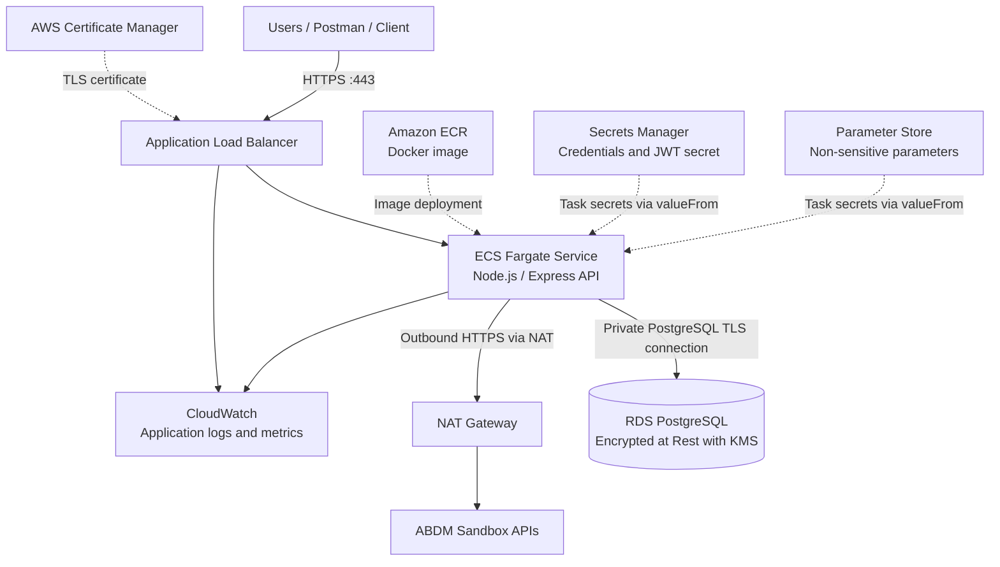

# Child Health API — AWS Deployment Guide

This document describes a small-pilot deployment of the Child Health API on **Amazon ECS with AWS Fargate**, using an **Application Load Balancer (ALB)** and **Amazon RDS for PostgreSQL**.

The proposed design runs the Node.js/Express backend as one modular application in a Docker container. It does not split individual API endpoints into separate Lambda functions.

> **Deployment status:** This is a deployment plan and implementation guide. It is not evidence that the AWS resources have already been created or that the API has been deployed.

---

## 1. Architecture overview

### Selected AWS services

| Responsibility | AWS service | Purpose |
|---|---|---|
| Application compute | Amazon ECS with AWS Fargate | Runs the Node.js/Express container without managing EC2 servers |
| API exposure | Application Load Balancer | Receives HTTPS traffic and forwards requests to healthy ECS tasks |
| Database | Amazon RDS for PostgreSQL | Stores guardian, child, and vaccination-reminder data |
| Container registry | Amazon Elastic Container Registry (ECR) | Stores versioned Docker images |
| Secrets | AWS Secrets Manager | Stores database credentials, JWT signing secret, and ABDM sandbox credentials |
| Configuration | AWS Systems Manager Parameter Store | Stores non-sensitive configuration values referenced by ECS tasks |
| Key management | AWS Key Management Service (KMS) | Manages encryption keys for RDS storage and optional customer-managed keys for secret decryption |
| TLS certificates | AWS Certificate Manager (ACM) | Provides the certificate used by the ALB HTTPS listener |
| Logs and monitoring | Amazon CloudWatch | Collects application logs, metrics, and alarms |
| AWS permissions | AWS Identity and Access Management (IAM) | Grants least-privilege permissions to deployment and application components |
| Network controls | Amazon VPC and Security Groups | Separates public entry points, application tasks, and the database |
| AWS activity auditing | AWS CloudTrail | Records AWS account activity and API actions |

### Architecture diagram



### Network placement

- **Public subnets:** Application Load Balancer and NAT Gateway.
- **Private application subnets:** ECS Fargate tasks.
- **Private database subnets:** RDS PostgreSQL, in a dedicated DB subnet group spanning at least two Availability Zones.
- **Database exposure:** RDS is not publicly accessible. Its security group accepts PostgreSQL traffic (port 5432) only from the ECS task security group.
- **Private subnet connectivity:** Private ECS tasks require network paths to reach AWS service endpoints during container launch and runtime:
  - **Amazon ECR API & Docker registry** (`ecr.api`, `ecr.dkr`) to authenticate and pull container images.
  - **Amazon S3** (`s3`) gateway endpoint to download ECR image layers (which are stored in S3).
  - **Amazon CloudWatch Logs** (`logs`) to stream container application logs.
  - **AWS Secrets Manager** (`secretsmanager`) to retrieve database credentials and JWT secrets at task initialization.
  - **AWS Systems Manager Parameter Store** (`ssm`) to fetch non-sensitive configuration parameters.
  - **External ABDM Sandbox APIs** for outbound healthcare interoperability calls over HTTPS (port 443).

  *Connectivity approach:* This connectivity can be provided through **AWS PrivateLink VPC Endpoints** (interface endpoints for ECR, CloudWatch, Secrets Manager, and SSM, plus a gateway endpoint for S3) or a **NAT Gateway** deployed in a public subnet. Private ECS tasks use the NAT Gateway for outbound HTTPS communication with external ABDM sandbox APIs. AWS VPC endpoints can provide private connectivity to supported AWS services, but **cannot replace internet routing for external ABDM endpoints**. Therefore, a **NAT Gateway** is the proposed option for this deployment. The NAT Gateway incurs an additional fixed hourly charge and per-gigabyte data-processing cost, which is accounted for in the pilot cost estimate.

For a more highly available production setup, distribute the ALB and application tasks across multiple Availability Zones and evaluate Multi-AZ RDS. The small-pilot baseline below is intentionally simpler and cheaper.

---

## 2. Application and database preparation

The current application uses SQLite. This deployment plan uses PostgreSQL so the database can be managed independently of the application containers and shared safely by multiple application tasks.

Before deployment:

1. **Install PostgreSQL driver:** Install the `pg` package as a production dependency (`npm install pg`).
2. **Update dependencies:** Update `package.json` and `package-lock.json` to record the PostgreSQL client.
3. **Adapt repository queries:** Replace SQLite-specific repository operations (such as `better-sqlite3` synchronous methods) with PostgreSQL-compatible asynchronous queries, connection pooling, and parameterized query syntax (`$1, $2`).
4. **Create PostgreSQL schema:** Create PostgreSQL tables for the existing entities: `guardians`, `children`, and `vaccination_reminders`.
5. **Preserve constraints:** Preserve primary keys, foreign keys (`ON DELETE CASCADE`), uniqueness constraints, and guardian ownership relationships.
6. **Prepare migrations:** Prepare and test database migrations.
7. **Migrate data:** Migrate any required existing data from SQLite and verify record counts and relationships.
8. **Update health-check probe:** Update the health-check database probe (`GET /health`) to verify PostgreSQL connectivity using a `SELECT 1` query against the connection pool.
9. **Test all operations:** Thoroughly test all database operations after migration (CRUD operations, constraints, error handling).
10. **Environment configuration:** Ensure the application reads database settings from environment variables or the configured secret references.
11. **Server binding:** Ensure the Express server listens on `0.0.0.0` and the configured container port (default below: `3000`).
12. **Readiness:** Ensure `GET /health` returns a successful response when the application is ready to receive traffic.

**Important:** The existing `better-sqlite3` repository code cannot connect to PostgreSQL unchanged. The database/repository layer must be adapted and tested before deploying this architecture.

### Database encryption in transit (TLS)

All communication between ECS Fargate tasks and Amazon RDS PostgreSQL must be encrypted in transit using SSL/TLS:

1. **Client TLS connection:** The Node.js PostgreSQL client (e.g., `pg`) establishes an encrypted TLS handshake when connecting to the database. The connection pool must specify the TLS configuration with certificate verification:
   ```javascript
   const fs = require('fs');
   const { Pool } = require('pg');

   const pool = new Pool({
     host: process.env.DB_HOST,
     port: parseInt(process.env.DB_PORT, 10) || 5432,
     database: process.env.DB_NAME,
     user: process.env.DB_USER,
     password: process.env.DB_PASSWORD,
     ssl: {
       rejectUnauthorized: true,
       ca: fs.readFileSync(process.env.RDS_CA_PATH || '/app/certs/global-bundle.pem').toString()
     }
   });
   ```
2. **AWS RDS CA bundle verification:** The client verifies the RDS server certificate against the official AWS RDS Certificate Authority bundle (such as `global-bundle.pem`), downloaded from the AWS trust store and included in the container image.
3. **Strict certificate verification (`rejectUnauthorized: true`):** Certificate verification must remain strictly enabled (`rejectUnauthorized: true`). Disabling certificate validation (`rejectUnauthorized: false`) creates vulnerability to man-in-the-middle (MITM) attacks and is prohibited.
4. **Enforcing TLS on RDS (`rds.force_ssl`):** In the custom RDS DB parameter group, set the parameter `rds.force_ssl = 1` (where supported by the selected PostgreSQL version). This enforces that PostgreSQL automatically rejects any unencrypted incoming connection attempts at the database engine level.

---

## 3. Containerize the API

Add a production Dockerfile to the project if one does not already exist. A basic example is shown below; adjust the entry point and package-manager commands to match the actual project.

```dockerfile
FROM node:22-alpine

WORKDIR /app

ENV NODE_ENV=production
ENV PORT=3000

COPY package*.json ./
RUN npm ci --omit=dev

COPY . .

EXPOSE 3000

CMD ["npm", "start"]
```

Add a `.dockerignore` file to ensure local SQLite databases, credentials, test artefacts, Postman folders, and development dependencies are not copied into the production Docker image:

```text
node_modules/
.git/
.env
.env.*
data/
*.db
*.db-*
*.sqlite
*.sqlite3
coverage/
*.log
postman/
.postman/
```

Build and test the image locally before pushing it to ECR:

```bash
docker build -t child-health-api:local .
docker run --rm -p 3000:3000 --env-file .env child-health-api:local
```

Then test the local container:

```bash
curl http://localhost:3000/health
```

Do not copy `.env` files or real credentials into the Docker image.

---

## 4. AWS deployment procedure

The following steps describe the deployment sequence. Resource names, account IDs, subnet IDs, security-group IDs, and certificate ARNs must be filled in with values from the target AWS account.

### Step 1 — Select the region and configure the AWS CLI

Use the AWS region selected for the project. For an India-based pilot, Mumbai (`ap-south-1`) is a reasonable starting point, subject to latency, service availability, and cost requirements.

Configure and verify the AWS CLI:

```bash
aws configure
aws sts get-caller-identity
```

Use an IAM identity with only the permissions needed for the deployment. Do not use root-account credentials for routine work.

### Step 2 — Create the ECR repository

Create a repository to store the API image:

```bash
aws ecr create-repository \
  --repository-name child-health-api \
  --image-scanning-configuration scanOnPush=true \
  --region ap-south-1
```

Authenticate Docker to ECR. Replace `<ACCOUNT_ID>` with the AWS account ID:

```bash
aws ecr get-login-password --region ap-south-1 | docker login \
  --username AWS \
  --password-stdin <ACCOUNT_ID>.dkr.ecr.ap-south-1.amazonaws.com
```

Build, tag, and push the image:

```bash
docker build -t child-health-api:latest .

docker tag child-health-api:latest \
  <ACCOUNT_ID>.dkr.ecr.ap-south-1.amazonaws.com/child-health-api:latest

docker push \
  <ACCOUNT_ID>.dkr.ecr.ap-south-1.amazonaws.com/child-health-api:latest
```

For repeatable deployments, use an immutable version tag (for example, a Git commit SHA) rather than relying only on `latest`.

### Step 3 — Create the RDS PostgreSQL database

Before provisioning RDS, verify the currently supported PostgreSQL engine versions in the target region using the AWS CLI:

```bash
aws rds describe-db-engine-versions \
  --engine postgres \
  --region ap-south-1 \
  --query "DBEngineVersions[?Status=='available'].EngineVersion" \
  --output table
```

Use the default currently supported version or a specific verified version. Avoid hardcoding unverified minor versions.

Create the RDS PostgreSQL instance with storage encryption and managed master credentials:

```bash
aws rds create-db-instance \
  --db-instance-identifier child-health-db \
  --db-instance-class db.t4g.micro \
  --engine postgres \
  --allocated-storage 20 \
  --storage-type gp3 \
  --storage-encrypted \
  --kms-key-id <KMS_KEY_ARN_OR_ALIAS> \
  --master-username dbadmin \
  --manage-master-user-password \
  --no-publicly-accessible \
  --db-subnet-group-name child-health-db-subnet-group \
  --vpc-security-group-ids <RDS_SECURITY_GROUP_ID> \
  --backup-retention-period 7 \
  --region ap-south-1
```

1. **Managed master credentials:** The `--manage-master-user-password` flag directs RDS to automatically generate the master password and store it securely in AWS Secrets Manager, including automatic rotation support.
2. **Dedicated application account (Least Privilege):** **The application must NOT connect using the RDS master account (`dbadmin`).** The master account is restricted to initial database setup and administrative tasks. A separate PostgreSQL application user (e.g., `child_health_app`) with restricted privileges (`CONNECT` on the database, `SELECT`, `INSERT`, `UPDATE` on application tables, and no DDL or superuser rights) must be created, and its credentials stored in AWS Secrets Manager for application use.
3. **Storage encryption at rest:**
   - `--storage-encrypted` explicitly enables AES-256 encryption at rest for the database storage.
   - For `--kms-key-id`, use either the AWS-managed key for Amazon RDS (`aws/rds`) or a Customer Managed Key (CMK) created in AWS KMS. A customer-managed CMK is recommended for sensitive healthcare data because it allows fine-grained access policies, independent key rotation, and dedicated CloudTrail auditing.
   - **Backups and snapshots:** When storage encryption is enabled on the RDS instance, all automated backups and manual DB snapshots are automatically encrypted at rest using the same KMS key.
   - **Read-replica encryption:** Same-region read replicas use the source database instance's KMS encryption key. However, cross-region read replicas require an appropriate KMS key in the destination region, as KMS keys are regional resources. The pilot does not configure read replicas. Note that RDS-managed master credentials through Secrets Manager are currently not supported when creating PostgreSQL read replicas from the source database. Revisit the credential-management configuration if read replicas are required in the future.
   - **KMS access control:** Access to customer-managed KMS keys must be strictly controlled through IAM policies and KMS key policies, ensuring only authorized deployment roles and the RDS service can perform cryptographic operations.
4. **Database network isolation:** Ensure public accessibility is disabled (`--no-publicly-accessible`). Place the database in private database subnets using a DB subnet group.
5. **Security group rules:** Configure the RDS security group to accept inbound TCP traffic on port `5432` exclusively from the ECS task security group.
6. **Enforce SSL/TLS:** Associate the instance with a custom DB parameter group where `rds.force_ssl = 1` is configured to mandate encrypted connections.
7. **Run migrations:** Execute database migrations from a secure runner or bastion within the VPC that can reach the private database.
8. **Verify connectivity:** Confirm that the application connects successfully over TLS and performs necessary CRUD operations.

Do not expose the RDS endpoint directly to the public internet.

### Step 4 — Store secrets and configuration

The deployment uses two complementary AWS services for configuration management:

#### 1. AWS Secrets Manager (Sensitive Credentials)
Store sensitive values in AWS Secrets Manager, for example:
- PostgreSQL application user credentials (`DB_USER`, `DB_PASSWORD`, `DB_HOST`, `DB_NAME`, `DB_PORT`).
- JWT signing secret (`JWT_SECRET`).
- ABDM sandbox credentials (client ID and client secret), when used.

#### 2. Systems Manager Parameter Store (Centralized Non-Sensitive Configuration)
Store centrally managed, non-sensitive configuration parameters in Parameter Store, for example:
- `/child-health/prod/abdm-base-url`
- `/child-health/prod/jwt-expires-in`
- `/child-health/prod/rate-limit-max`

#### Configuration retrieval in ECS task definitions

A clear distinction exists between the two configuration mechanisms in the ECS task definition:

- **Ordinary task-definition environment variables (`environment` array):** Used for static values configured directly within the task definition (e.g., `NODE_ENV=production`, `PORT=3000`).
- **Referenced parameters and secrets (`secrets` array):** Both Secrets Manager secrets and Parameter Store parameters referenced by the container must use the `secrets` array in `containerDefinitions`, specifying the environment variable `name` and the `valueFrom` property set to the ARN of the secret or parameter:
  ```json
  "secrets": [
    {
      "name": "DB_PASSWORD",
      "valueFrom": "<FULL_DB_CREDENTIALS_SECRET_ARN>:password::"
    },
    {
      "name": "JWT_SECRET",
      "valueFrom": "<FULL_JWT_SECRET_ARN>"
    },
    {
      "name": "ABDM_BASE_URL",
      "valueFrom": "arn:aws:ssm:ap-south-1:<ACCOUNT_ID>:parameter/child-health/prod/abdm-base-url"
    }
  ]
  ```

#### IAM permission model for configuration retrieval

- **ECS Task Execution Role:** When values are referenced via the task definition's `secrets` block, the **ECS container agent** (AWS infrastructure) retrieves the values from Secrets Manager and Parameter Store before starting the container. Therefore, `secretsmanager:GetSecretValue` and `ssm:GetParameters` permissions belong on the **Task Execution Role**.
- **Application Task Role:** The application running inside the container receives all configuration as standard environment variables (`process.env.DB_PASSWORD`, `process.env.ABDM_BASE_URL`). The application makes no direct runtime SDK calls to Secrets Manager or Parameter Store. Consequently, the Application Task Role requires **no** Secrets Manager, Parameter Store, or KMS permissions for configuration.

Avoid placing secrets in source control, task-definition plaintext environment fields, Docker build arguments, or container image layers.

### Step 5 — Create the ECS Fargate service

1. **Create an ECS cluster:**
   ```bash
   aws ecs create-cluster --cluster-name child-health-cluster --region ap-south-1
   ```
2. **Create the ECS Task Execution Role (`ecsTaskExecutionRole`):**
   - Attach the AWS-managed policy `AmazonECSTaskExecutionRolePolicy` (allows pulling images from ECR and streaming logs to CloudWatch).
   - Attach an inline policy granting permissions to retrieve task secrets and parameters:
     ```json
     {
       "Version": "2012-10-17",
       "Statement": [
         {
           "Effect": "Allow",
           "Action": [
             "secretsmanager:GetSecretValue"
           ],
           "Resource": [
             "arn:aws:secretsmanager:ap-south-1:<ACCOUNT_ID>:secret:child-health/*"
           ]
         },
         {
           "Effect": "Allow",
           "Action": [
             "ssm:GetParameters"
           ],
           "Resource": [
             "arn:aws:ssm:ap-south-1:<ACCOUNT_ID>:parameter/child-health/*"
           ]
         }
       ]
     }
     ```
   - **Conditional KMS permissions:** If any referenced Secrets Manager secret or SSM `SecureString` parameter is encrypted using a **Customer Managed Key (CMK)**, add a scoped statement allowing `kms:Decrypt` for that specific key ARN:
     ```json
     {
       "Effect": "Allow",
       "Action": [
         "kms:Decrypt"
       ],
       "Resource": [
         "arn:aws:kms:ap-south-1:<ACCOUNT_ID>:key/<SECRET_ENCRYPTION_KEY_ID>"
       ]
     }
     ```
     *Note:* If secrets use the default AWS-managed key (`aws/secretsmanager` or `aws/ssm`), explicit `kms:Decrypt` permissions are not required. **Do not automatically reuse the RDS storage encryption key for secret decryption**; database storage encryption and application-secret encryption are separate security domains and typically use distinct KMS keys.
3. **Create the Application Task Role (`ecsTaskRole`):**
   - This role is assumed by the Node.js application process at runtime.
   - Because credentials and configuration are supplied as injected environment variables at startup, the application requires no direct AWS API access for basic operations. Keep this role minimal (empty or scoped only to future application-level AWS calls such as direct S3 document uploads).
4. **Register the Task Definition:**
   - Specify `requiresCompatibilities: ["FARGATE"]`, `networkMode: "awsvpc"`, and pilot compute sizing (e.g., `cpu: "256"`, `memory: "512"`).
   - In `containerDefinitions`, map sensitive values and Parameter Store parameters using `secrets` (`valueFrom`), and static plaintext values using `environment`.
   - Configure the log driver to use `awslogs` targeting a CloudWatch log group.
5. **Private subnet routing:** Deploy the Fargate tasks into private application subnets whose route tables route `0.0.0.0/0` to the NAT Gateway (or use VPC endpoints) so the ECS agent can reach ECR, CloudWatch, and Secrets Manager.
6. **Task security group:** Configure the ECS task security group to accept inbound traffic on port `3000` exclusively from the ALB security group.
7. **Create the ECS Service:**
   - Set desired task count to `1` for the pilot.
   - Attach the service to the ALB target group.

### Step 6 — Configure the Application Load Balancer and HTTPS

1. Create an internet-facing Application Load Balancer in public subnets across at least two Availability Zones.
2. Create a target group with target type `ip` (required for Fargate `awsvpc` mode) targeting port `3000`. Configure the health check path to `/health`.
3. Request or import an ACM public TLS certificate for the API domain.
4. Configure an ALB HTTPS listener on port `443` with the ACM certificate attached.
5. Configure an HTTP listener on port `80` that redirects all traffic to HTTPS port `443` with a `301 Moved Permanently` response.
6. Configure the ALB security group to accept public inbound traffic on ports `80` and `443` from `0.0.0.0/0`.
7. Associate the ECS service with the target group and verify that Fargate tasks register and pass health checks.

### Step 7 — Configure logging, metrics, and alarms

Send application logs to CloudWatch Logs. Configure CloudWatch metrics and alarms for relevant signals, such as:

- ALB HTTP 5xx responses and unhealthy targets.
- ECS CPU and memory utilisation.
- ECS task count and task restarts.
- RDS CPU, free storage, database connections, and freeable memory.
- Application-specific error rates, if emitted as custom metrics.

Enable CloudTrail for AWS account activity. CloudTrail is not a substitute for application audit logs.

### Step 8 — Verify the deployment

#### A. Basic health and endpoint verification

Verify the live health check via the ALB DNS name or configured API domain:

```bash
curl -i https://<API_DOMAIN>/health
```

Verify all API routes using Postman or curl:

```text
POST /auth/register
POST /auth/login
POST /children
GET  /children/:id
POST /reminders
GET  /health
```

Verify key security and business rules:

- A valid guardian can register and authenticate.
- An authenticated guardian can access their registered child's profile.
- A guardian cannot access another guardian's child (BOLA / IDOR returns `403 Forbidden`).
- Invalid, expired, or tampered JWTs return `401 Unauthorized`.
- Reminder creation enforces child ownership and active granted consent.
- ALB marks unhealthy tasks as unhealthy and routes traffic only to healthy tasks.
- Logs in CloudWatch do not contain passwords, JWTs, database credentials, or unnecessary patient data.

#### B. Database persistence verification test

To confirm that the application correctly persists records in Amazon RDS PostgreSQL and does not depend on the container's ephemeral local filesystem:

1. **Create a child record:** Call `POST /children` with an authenticated guardian JWT and record the returned child ID:
   ```bash
   curl -X POST https://<API_DOMAIN>/children \
     -H "Authorization: Bearer <TOKEN>" \
     -H "Content-Type: application/json" \
     -d '{
       "name": "Test Persistence Child",
       "dateOfBirth": "2024-01-15",
       "guardianName": "User One",
       "state": "Maharashtra",
       "consentStatus": "granted"
     }'
   ```
   Note the generated `id` from the `201 Created` response (e.g., `test-child-uuid-12345`).
2. **Restart / replace the ECS task:** Force a new deployment of the ECS service to destroy the existing container and launch a fresh task:
   ```bash
   aws ecs update-service \
     --cluster child-health-cluster \
     --service child-health-service \
     --force-new-deployment \
     --region ap-south-1
   ```
3. **Wait for task replacement:** Monitor the ECS console or CLI until the old task stops and the new Fargate task becomes healthy in the ALB target group.
4. **Retrieve the child record:** Query `GET /children/<child_id>` using the new container task:
   ```bash
   curl -i https://<API_DOMAIN>/children/test-child-uuid-12345 \
     -H "Authorization: Bearer <TOKEN>"
   ```
5. **Confirm persistence:** Verify that the endpoint returns `200 OK` with the identical child record. This confirms that data is stored safely in RDS PostgreSQL, surviving container termination, deployments, and restarts without relying on container local storage.

---

## 5. Security and access control

### Network security

| Component | Inbound access | Outbound access |
|---|---|---|
| ALB | Public HTTPS on `443`; HTTP `80` only for redirect to `443` | Forward traffic to ECS target port (`3000`) in private subnets |
| ECS tasks | Application port (`3000`) from ALB security group only | Port `5432` to RDS security group; outbound HTTPS via NAT Gateway for external ABDM sandbox APIs and AWS endpoints |
| RDS | PostgreSQL port `5432` from ECS task security group only | No public inbound access; traffic isolated within private database subnets |

### Data security & encryption

- **Encryption in transit:**
  - **External traffic:** HTTPS enforced at the ALB with modern TLS termination via ACM. Port 80 automatically redirects to port 443.
  - **Internal database traffic:** Strict TLS encrypted connection between ECS Fargate tasks and Amazon RDS PostgreSQL with RDS CA bundle verification (`rejectUnauthorized: true`) and `rds.force_ssl = 1` in the DB parameter group.
- **Encryption at rest:**
  - **Database storage:** Amazon RDS PostgreSQL storage encrypted using AWS KMS (AES-256) with an AWS-managed key (`aws/rds`) or Customer Managed Key (CMK).
  - **Backups and snapshots:** All automated backups and manual DB snapshots associated with the encrypted RDS instance are automatically encrypted using the same KMS key.
  - **Read replicas:** Same-region read replicas use the source instance's KMS key; cross-region read replicas require an appropriate KMS key in the destination region.
  - **Key governance:** Customer-managed KMS keys are protected by strict IAM and key policies, with access restricted to authorized deployment roles and the RDS service.
  - **Secret storage:** All credentials, JWT signing keys, and external API keys are stored encrypted in AWS Secrets Manager.

### IAM security

- **Strict role separation:**
  - **Task Execution Role:** Used exclusively by the ECS agent for infrastructure operations: pulling images from ECR, sending logs to CloudWatch, and retrieving/decrypting secrets and parameters at task startup.
  - **Task Role:** Used by the application code at runtime. Scoped strictly to runtime AWS SDK calls; secret-retrieval permissions are omitted because configuration is provided as injected environment variables.
- **Least privilege:** Allow access only to specific ARNs for the ECR repository, CloudWatch log group, Secrets Manager secrets, Parameter Store parameters, and any secret-encryption KMS keys.
- **No static credentials:** Zero long-lived AWS access keys stored in source code, Docker images, or container filesystems.

### Application security

- Keep JWT authentication enabled for protected API routes with algorithm pinned to `HS256` and 1-hour expiration.
- Enforce guardian ownership checks on child and reminder resources (`req.guardian.id`).
- Enforce active granted consent checks before scheduling reminders.
- Validate request payloads and apply rate limiting (global 100 req/15 min; auth 15 req/15 min).
- Restrict request body size to 10 KB to prevent memory exhaustion attacks.
- Centralized error handler masks internal database details and stack traces.
- Do not log sensitive request/response bodies, passwords, tokens, or unnecessary patient data.

---

## 6. Backup and recovery

For the pilot RDS PostgreSQL database:

1. **Automated backups:** Enable automated backups with a retention period of 7 days. Backups are automatically encrypted at rest using the instance's KMS key.
2. **Manual snapshots:** Take manual DB snapshots prior to database schema migrations and major software releases. Snapshots inherit KMS encryption. Cross-region snapshot copies require a destination-region KMS key.
3. **Point-in-time recovery (PITR):** Leverage continuous archiving in RDS PostgreSQL to restore the database to any second within the retention window in the event of logical data corruption or accidental deletion.
4. **Restoration testing:** Periodically restore a snapshot to a temporary test database to verify database integrity and application compatibility.
5. **Access control:** Restrict snapshot creation, deletion, and sharing permissions through IAM policies because backups contain sensitive pediatric healthcare information.

For a production deployment, define recovery objectives (RPO and RTO), assess Multi-AZ RDS for automated failover, and document formal disaster recovery runbooks. A backup is not considered verified until a restore has been tested.

---

## 7. Small-pilot cost considerations

The following is an **approximate small-pilot planning estimate** of around **USD 85–120+ per month**, not a live AWS quotation or guaranteed price. The overall budget includes a planning allowance for regional pricing variations and variable usage that may not be fully represented in the individual component estimates. Actual charges vary based on AWS region, allocated compute/memory, database storage, uptime, network data transfer, log volume, and request rates.

### Indicative monthly cost breakdown (Mumbai: `ap-south-1`)

| Component | Sizing & Configuration | Estimated Monthly Cost (USD) | Cost Behaviour |
|---|---|---|---|
| **ECS Fargate** | 1 continuously running task (0.25 vCPU, 0.5 GB RAM) | ~$9 – $15 | Billed per vCPU-hour and GB-hour of running tasks |
| **Application Load Balancer** | 1 internet-facing ALB (Single-region, ~0.5–1 LCU) | ~$16 – $22 | Hourly fixed fee plus Load Balancer Capacity Units (LCU) |
| **Amazon RDS PostgreSQL** | 1 Single-AZ `db.t4g.micro` or `db.t3.micro` (20 GB gp3 storage) | ~$15 – $20 | Instance runtime plus allocated storage; Single-AZ is cost-effective for pilots |
| **NAT Gateway** | 1 NAT Gateway in public subnet (minimal data processing) | ~$32 – $38 | Hourly fixed charge plus per-GB data processing fee |
| **Supporting Services** | ECR, Secrets Manager, Parameter Store, CloudWatch Logs/Metrics, AWS KMS | ~$5 – $10 | Low base usage; pay-per-secret, per-metric, and per-GB log ingestion |
| **Data Transfer** | Low pilot volume (egress to internet and ABDM sandbox) | ~$2 – $5 | Inbound free; outbound billed per GB after free tier |
| **Total Estimated Range** | **Small-Pilot Deployment Baseline** | **~$85 – $120+ / month** | **Baseline estimate for continuously running infrastructure** |

### Key cost assumptions
- **Region:** AWS Asia Pacific (Mumbai) `ap-south-1`.
- **Compute:** One continuously running Fargate task without autoscaling during the initial pilot phase.
- **Database:** Single-AZ RDS PostgreSQL deployment (Multi-AZ roughly doubles RDS instance and storage costs).
- **Network egress:** A single NAT Gateway deployed in one Availability Zone to support outbound ABDM sandbox and AWS service traffic from private subnets.
- **Traffic volume:** Low pilot traffic with negligible data egress.

### Cost optimisation options
- **Scale-to-zero / dev scheduling:** Stop or scale Fargate service to 0 tasks outside testing hours if the pilot does not require 24/7 uptime.
- **NAT Gateway evaluation:** For environments without external internet requirements, replacing the NAT Gateway with VPC endpoints can optimize costs if data volumes are low. However, external ABDM sandbox calls require public internet routing via NAT.
- **Log retention policies:** Configure CloudWatch log groups with a 7-day or 14-day retention policy rather than indefinite retention.
- **ECR lifecycle policies:** Automatically expire untagged or older container images to maintain storage below 5 GB.
- **Database sizing:** Revisit instance class and gp3 IOPS settings based on actual measured CloudWatch database load.

For exact, up-to-date pricing based on specific operational parameters, use the official [AWS Pricing Calculator](https://calculator.aws/).

---

## 8. Deployment summary

The proposed deployment uses **ECS Fargate + Application Load Balancer + RDS PostgreSQL**.

This architecture keeps the Child Health API as one cohesive backend, avoids managing EC2 operating systems, provides persistent relational storage, and supports scaling by increasing the number of Fargate tasks. It is a practical balance for a small pilot, although the ALB, RDS, and NAT Gateway create baseline costs that should be checked before deployment.

### Alternative considered: AWS Lambda

Lambda remains a valid alternative, particularly for low-volume or irregular workloads where pay-per-execution economics are important. It can be used with API Gateway and a managed database. The core API could be retained behind a Lambda adapter or divided into domain-oriented functions; creating one function per CRUD endpoint is not mandatory. Fargate is selected here because the proposed design favours a continuously running, cohesive backend and straightforward container-based deployment.
