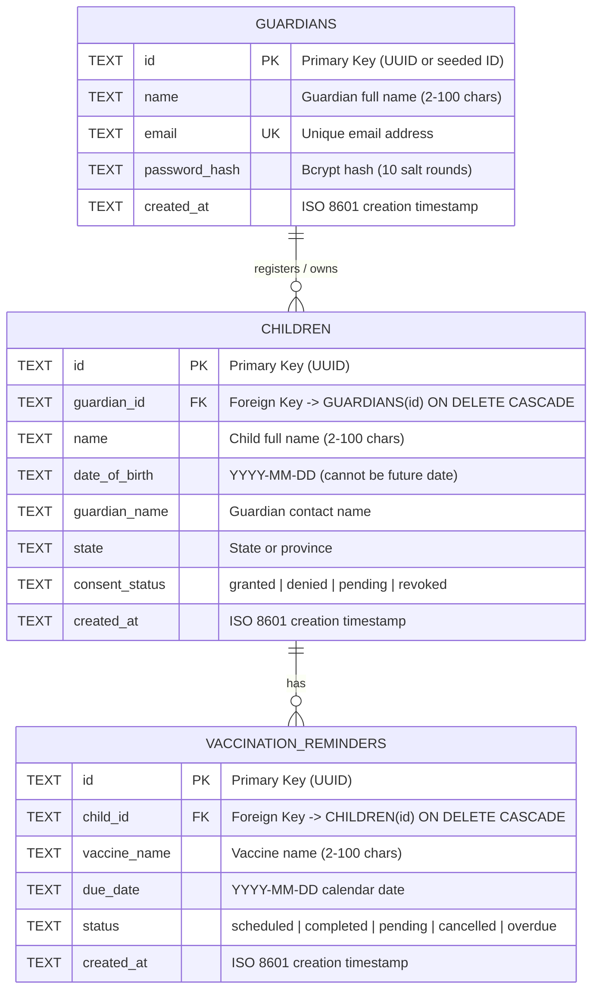

# Child Health API

A robust, modular REST API built with **Node.js**, **Express.js**, and persistent **SQLite** storage for child health profile management and vaccination reminder tracking.

---

## 🌟 Security Architecture & Implementation

### 1. Identity, Authentication & JWT Access Control
- **Signed JSON Web Tokens (JWT)**: Replaced mock token storage with stateless, cryptographically signed JWTs using `jsonwebtoken`.
- **Minimized Token Payload**:
  ```json
  {
    "sub": "guardian-user1",
    "iss": "child-health-api",
    "aud": "child-health-api",
    "iat": 1730456000,
    "exp": 1730459600
  }
  ```
  *(Personal details like emails and passwords are omitted from the payload to adhere to data minimization).*
- **Cryptographic Algorithm Pinning**: Both signing and verification are strictly pinned to `HS256`, explicitly rejecting insecure algorithms like `none`.
- **Token Expiry**: Defaults to `1h` (1 hour) to limit the attack window if a token is intercepted, as recommended for sensitive pediatric healthcare systems.
- **Password Security (Bcrypt)**:
  - Passwords are hashed using `bcryptjs` with a work factor of 10.
  - Enforces a maximum password length limit of **72 bytes** (`Buffer.byteLength(password, 'utf8') <= 72`) to eliminate silent truncation vulnerabilities inherent to bcrypt.
  - Mitigates timing-based account enumeration attacks by executing a dummy bcrypt comparison when an email is not found.
- **Strict Rate Limiting on Auth**: Both `POST /auth/login` and `POST /auth/register` are protected by a dedicated rate limiter (15 attempts per 15 minutes, configurable via `AUTH_RATE_LIMIT_MAX`) to prevent brute-force attacks and automated registration spam.
- **Preserved Ownership Architecture**: The verified subject claim `decoded.sub` is mapped to `req.guardian = { id: decoded.sub }`. The client is never trusted to specify `guardianId` for authorization.
- **Pre-seeded Test Accounts**:
  | Username / Email | Password | Guardian ID | Role / Test Purpose |
  |---|---|---|---|
  | `user1` (`user1@example.com`) | `user1` | `guardian-user1` | Primary guardian for registrations & reminders |
  | `user2` (`user2@example.com`) | `user2` | `guardian-user2` | Secondary guardian for cross-access denial testing |
  | `user3` (`user3@example.com`) | `user3` | `guardian-user3` | Additional test identity |

### 2. Consent & Data Protection
- **Standardized Consent Lifecycle**: Enforces standardized consent statuses (`'granted'`, `'denied'`, `'pending'`, `'revoked'`). Booleans (`true`/`false`) are automatically normalized to `'granted'`/`'denied'`.
- **Consent Pre-condition Check**: Vaccination reminders are blocked with `403 Forbidden` if active granted consent is not present on the child record.
- **Data Minimization**: API responses expose only required profile fields, omitting internal foreign keys, credentials, or tokens.
- **Redacted Safe Logging**: Request logging explicitly strips authorization headers, tokens, and sensitive personal identifiable information (PII) from log streams.

### 3. Application-Level Protection
- **Helmet Security Headers**: Injects HTTP security headers including `Content-Security-Policy`, `X-Content-Type-Options: nosniff`, `X-Frame-Options: SAMEORIGIN`, and `Strict-Transport-Security`.
- **CORS Configuration**: Configures cross-origin access control policies.
- **Request Body Size Limits**: Enforces a strict `10kb` body size limit on JSON payloads to prevent memory exhaustion and payload injection attacks.
- **Rate Limiting**: Protects endpoints against brute-force and denial-of-service attempts via `express-rate-limit` with standard HTTP rate limit headers.
- **Centralized Error Boundary**: Sanitizes operational and database errors to prevent leaking internal stack traces or SQL statements.

---

## 🗄️ Database Architecture & Entity-Relationship Model

The application utilizes persistent **SQLite** via the high-performance, synchronous `better-sqlite3` driver.

- **Referential Integrity**: `PRAGMA foreign_keys = ON;` is enforced on every database connection, ensuring relational constraints and cascading deletes (`ON DELETE CASCADE`).
- **Concurrent Access & Durability**: `PRAGMA journal_mode = WAL;` (Write-Ahead Logging) is enabled for disk storage, allowing concurrent readers alongside writers, fast transactions, and crash safety.
- **SQL Injection Defense**: 100% of data access queries across repositories use parameterized prepared statements (`db.prepare(...)`).
- **Indexes**: Dedicated B-tree indexes (`idx_guardians_email`, `idx_children_guardian_id`, `idx_reminders_child_id`) optimize lookup performance.



---

## 📁 Project Structure

```text
ChildHealthAPI/
├── controllers/
│   ├── authController.js           # Handles guardian registration and login
│   ├── childController.js          # Handles child registration & profile retrieval
│   ├── healthController.js         # Health check and database connectivity probe
│   └── reminderController.js       # Handles vaccination reminder scheduling
├── database/
│   ├── db.js                       # SQLite initialization, pragmas, and schema migrations
│   ├── childRepository.js          # Parameterized data access for children table
│   ├── guardianRepository.js       # Parameterized data access for guardians table
│   └── reminderRepository.js       # Parameterized data access for reminders table
├── middleware/
│   ├── auth.js                     # JWT verification & ownership binding middleware
│   ├── errorHandler.js             # Centralized JSON error handling
│   ├── logger.js                   # Safe request logging redacting sensitive headers
│   └── rateLimiter.js              # Configurable rate limiting (global & auth)
├── routes/
│   ├── authRoutes.js               # Express routing for /auth
│   ├── childRoutes.js              # Express routing for /children
│   ├── healthRoutes.js             # Express routing for /health
│   └── reminderRoutes.js           # Express routing for /reminders
├── services/
│   ├── authService.js              # Bcrypt hashing, verification & JWT generation
│   ├── childService.js             # Child business logic & UUID generation
│   └── reminderService.js          # Reminder business logic, ownership & consent checks
├── utils/
│   ├── AppError.js                 # Custom operational error wrapper
│   └── validator.js                # Input sanitization and calendar date validation
├── tests/
│   └── api.test.js                 # Comprehensive Jest & Supertest integration suite
├── test/
│   └── sample-tests.js             # Standalone runner test script
├── data/                           # Directory storing SQLite database file (gitignored)
├── .env.example                    # Template environment variables
├── .gitignore                      # Git exclusion rules
├── ChildHealthAPI.postman_collection.json # Exportable Postman collection (15 tests)
├── app.js                          # Express application pipeline & middleware configuration
├── server.js                       # HTTP server bootstrap and graceful shutdown hooks
├── package.json                    # Project metadata, scripts, and dependencies
└── README.md                       # Documentation
```

---

## ⚙️ Environment Configuration

Optional environment variables:

| Variable | Default Value | Description |
|---|---|---|
| `PORT` | `3000` | Port for the HTTP server |
| `NODE_ENV` | `development` | Setting to `test` runs the database in `:memory:` |
| `DB_PATH` | `./data/child_health.db` | Custom file path for SQLite database |
| `JWT_SECRET` | `child-health-api-jwt-secret-key-2026` | Secret key for HMAC-SHA256 JWT signing |
| `JWT_EXPIRES_IN` | `1h` | Access token lifespan (e.g. `1h`, `24h`) |
| `CORS_ORIGIN` | `*` | Allowed CORS origins |
| `RATE_LIMIT_MAX` | `100` | Max requests per global rate limit window |
| `RATE_LIMIT_WINDOW_MS` | `900000` (15 mins) | Duration for rate limit window |
| `AUTH_RATE_LIMIT_MAX` | `15` | Max requests per auth rate limit window (login/register) |

---

## 🛠️ Installation & Setup

### Prerequisites
- **Node.js** (v18.0.0 or higher)
- **npm** (v9.0.0 or higher)

### 1. Install Dependencies
```bash
npm install
```

### 2. Start the Server
```bash
npm start
```
Or with automatic reload during development:
```bash
npm run dev
```

The server will listen at:
```
http://localhost:3000
```

---

## 🧪 Testing

The project provides three testing options depending on your workflow:

### 1. Comprehensive Automated Suite (Jest & Supertest)
Runs 21 automated integration tests against an isolated in-memory SQLite database (`:memory:`):
```bash
npm test
```
Run with coverage:
```bash
npm run test:coverage
```

### 2. Standalone End-to-End Suite (Native Node.js HTTP)
Runs 14 automated tests spinning up an ephemeral local server and issuing real TCP/IP HTTP requests:
```bash
node test/sample-tests.js
```

### 3. Interactive Postman Collection
Import `ChildHealthAPI.postman_collection.json` directly into Postman. It includes 15 pre-configured requests with automated test assertions, dynamic token capture, and BOLA/IDOR security checks against your running server (`http://localhost:3000`).

---

## 📡 API Reference

### 1. Health Check
Checks system health, uptime, and live SQLite database connectivity.

- **Method**: `GET`
- **Endpoint**: `/health`
- **Authentication**: None (Public)
- **Response Code**: `200 OK`

```bash
curl http://localhost:3000/health
```

---

### 2. Guardian Login
Authenticates credentials and returns a signed JWT.

- **Method**: `POST`
- **Endpoint**: `/auth/login`
- **Headers**: `Content-Type: application/json`
- **Response Code**: `200 OK` (`400 Bad Request`, `401 Unauthorized`)

#### Sample Request:
```bash
curl -X POST http://localhost:3000/auth/login \
  -H "Content-Type: application/json" \
  -d '{
    "username": "user1",
    "password": "user1"
  }'
```

#### Sample Response (`200 OK`):
```json
{
  "message": "Authentication successful",
  "token": "eyJhbGciOiJIUzI1NiIsInR5cCI6IkpXVCJ9.eyJzdWIiOiJndWFyZGlhbi11c2VyMSIsImlzcyI6ImNoaWxkLWhlYWx0aC1hcGkiLCJhdWQiOiJjaGlsZC1oZWFsdGgtYXBpIiwiaWF0IjoxNzMwNDU2MDAwLCJleHAioxNzMwNDU5NjAwfQ...",
  "guardian": {
    "id": "guardian-user1",
    "name": "User One",
    "email": "user1@example.com"
  },
  "expiresIn": "1h"
}
```

---

### 3. Guardian Registration
Registers a new guardian and returns a signed JWT.

- **Method**: `POST`
- **Endpoint**: `/auth/register`
- **Headers**: `Content-Type: application/json`
- **Response Code**: `201 Created` (`400 Bad Request`, `409 Conflict`)

#### Sample Request:
```bash
curl -X POST http://localhost:3000/auth/register \
  -H "Content-Type: application/json" \
  -d '{
    "name": "Sunita Rao",
    "email": "sunita.rao@example.com",
    "password": "SecurePassword123"
  }'
```

---

### 4. Register Child
Registers a child profile linked to the authenticated guardian.

- **Method**: `POST`
- **Endpoint**: `/children`
- **Headers**:
  - `Content-Type: application/json`
  - `Authorization: Bearer <your_jwt_token>`
- **Response Code**: `201 Created` (`400 Bad Request`, `401 Unauthorized`)

#### Sample Request:
```bash
curl -X POST http://localhost:3000/children \
  -H "Content-Type: application/json" \
  -H "Authorization: Bearer <your_jwt_token>" \
  -d '{
    "name": "Aarav Sharma",
    "dateOfBirth": "2023-04-12",
    "guardianName": "User One",
    "state": "Maharashtra",
    "consentStatus": "granted"
  }'
```

---

### 5. Retrieve Child Profile
Fetches a child profile. Requires guardian ownership.

- **Method**: `GET`
- **Endpoint**: `/children/:id`
- **Headers**: `Authorization: Bearer <your_jwt_token>`
- **Response Code**: `200 OK` (`401 Unauthorized`, `403 Forbidden`, `404 Not Found`)

```bash
curl http://localhost:3000/children/<child_id> \
  -H "Authorization: Bearer <your_jwt_token>"
```

---

### 6. Create Vaccination Reminder
Schedules a reminder for a child. Enforces guardian ownership and active granted consent.

- **Method**: `POST`
- **Endpoint**: `/reminders`
- **Headers**:
  - `Content-Type: application/json`
  - `Authorization: Bearer <your_jwt_token>`
- **Response Code**: `201 Created` (`400 Bad Request`, `401 Unauthorized`, `403 Forbidden`, `404 Not Found`)

```bash
curl -X POST http://localhost:3000/reminders \
  -H "Content-Type: application/json" \
  -H "Authorization: Bearer <your_jwt_token>" \
  -d '{
    "childId": "<child_id>",
    "vaccineName": "MMR Dose 1",
    "dueDate": "2026-12-15",
    "status": "scheduled"
  }'
```

---

## 🛡️ Error Response Structure

All application errors return structured JSON:

| Scenario | HTTP Status | Format |
|---|---|---|
| Missing or invalid Bearer token | `401 Unauthorized` | `{"error": "Unauthorized", "message": "..."}` |
| Token expired | `401 Unauthorized` | `{"error": "Unauthorized", "message": "Authorization token has expired..."}` |
| Cross-guardian access attempt | `403 Forbidden` | `{"error": "Forbidden", "message": "..."}` |
| Reminder creation without consent | `403 Forbidden` | `{"error": "Consent Required", "message": "..."}` |
| Validation failure | `400 Bad Request` | `{"error": "Validation Error", "details": ["..."]}` |
| Duplicate email registration | `409 Conflict` | `{"error": "Conflict", "message": "..."}` |
| Body size exceeds 10kb | `413 Payload Too Large` | `{"error": "Payload Too Large", "message": "..."}` |
| Rate limit exceeded | `429 Too Many Requests` | `{"error": "Too Many Requests", "message": "..."}` |
| Unhandled server error | `500 Internal Server Error` | `{"error": "Internal Server Error", "message": "..."}` |
